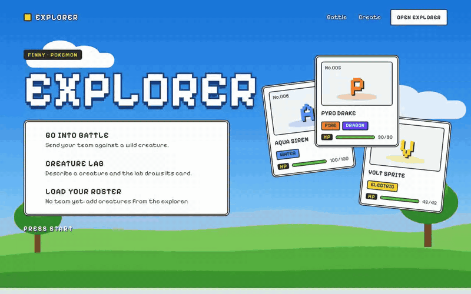
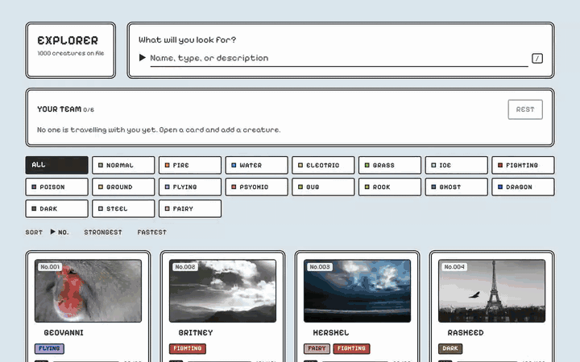
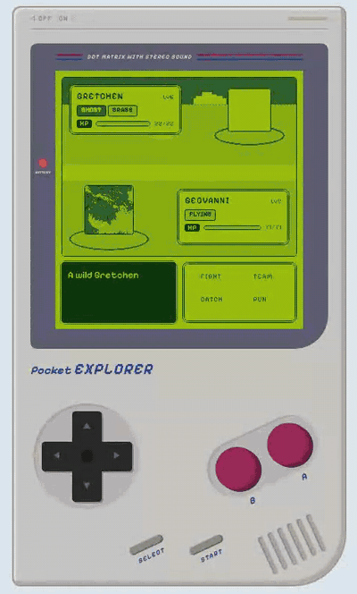
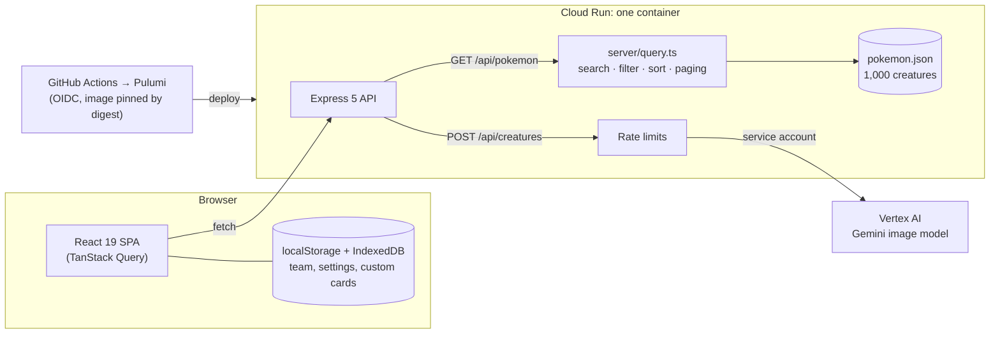

# Pokemon Explorer

FINNY frontend take-home: a searchable, infinitely scrolling grid of 1,000 creatures with expandable cards, plus
a turn-based battle on a handheld console and a Creature Lab.

**Live:** https://pokemon-explorer-605570978921.us-central1.run.app

<p align="center"></p>

## Explorer

Search by name, type or description, filter by type, sort by number, strength or speed, and keep scrolling: the
next batch loads on its own. Click a card for its stats and description; add up to six to your team.

<p align="center"></p>

## Battle

Your team fights wild creatures on a "Pocket Explorer" handheld. Choose a move and stop the timing bar in the middle
for extra damage; win to level up, or catch the wild creature. **Classic** switches between the four-green screen
and full color.

<p align="center"></p>

## Creature Lab

Name a creature, pick its types, describe it, and Gemini on Vertex AI draws its card (deployed app or local Google
Cloud credentials only).

## Architecture

One Cloud Run container serves the React app and the Express API. The creatures are a JSON file bundled with the
server, so search, filter, sort and paging run in `server/query.ts` with no database. Your team and custom cards
stay in your browser.



Infra details: [`docs/deployment.md`](docs/deployment.md). Decisions: [`docs/decisions.md`](docs/decisions.md).

## Run it

```bash
pnpm install
pnpm dev        # http://localhost:5173 (app + API)
pnpm test
pnpm lint && pnpm build && pnpm start   # production build on http://localhost:3000
```
