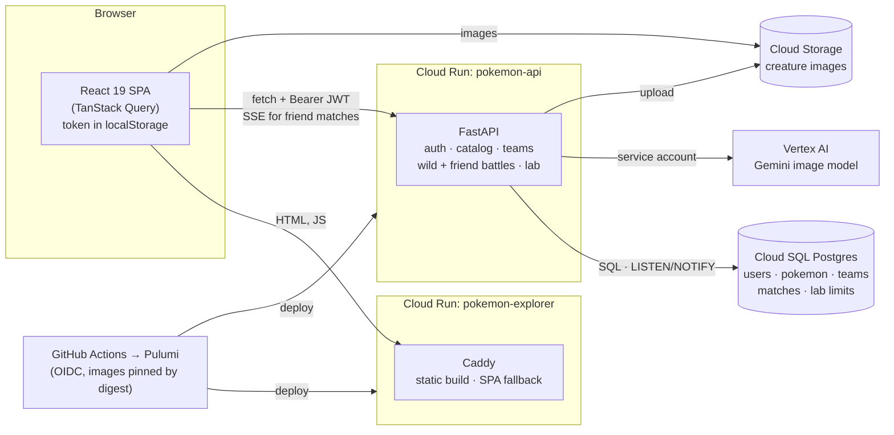

# Pokemon Explorer

FINNY frontend take-home: a searchable, infinitely scrolling grid of 1,000 creatures with expandable cards, plus
a turn-based battle on a handheld console and a Creature Lab. You sign in first; your team, creatures and battles live
on the server (FastAPI on Postgres).

**Live:** https://pokemon-explorer-605570978921.us-central1.run.app

<p align="center"></p>

## Explorer

Search by name, type or description, filter by type, sort by number, strength or speed, and keep scrolling: the
next batch loads on its own. Click a card for its stats and description; add up to six to your team.

<p align="center"></p>

## Battle

Your team fights wild creatures on a "Pocket Explorer" handheld. Choose a move and stop the timing bar in the middle
for extra damage; win to level up, or catch the wild creature. **Classic** switches between the four-green screen
and full color.

<p align="center"></p>

## Battle a friend

On Battle, choose **Battle a friend** and **Create match**, then send the link to a friend (or open it in a second
tab). Each of you picks up to six creatures; everyone fights at Lv50 and nothing is saved to your team. Both pick a
move each turn and the server settles it. Reload and you rejoin; a player who stays away for 60 seconds in the
battle forfeits. The API keeps matches in Postgres and pushes each turn to both browsers over server-sent events.

## Creature Lab

Name a creature, pick its types, describe it, and Gemini on Vertex AI draws its card. It's saved to your account, and
it can join your team and battle (deployed app or local Google Cloud credentials only).

## Architecture

Two Cloud Run services. The frontend is static files: the Vite build served by Caddy. The API is FastAPI on Cloud SQL
Postgres; it runs every battle, keeps teams and accounts, and draws Creature Lab images with Vertex AI into a public
bucket that the browser loads from directly.



API docs (Swagger) are at `/api/docs` on the API service. Infra details: [`docs/deployment.md`](docs/deployment.md).

## Run it

```bash
pnpm install
docker compose up -d --wait db   # Postgres on :54329
pnpm dev:api                     # FastAPI on http://localhost:8000 (runs migrations)
pnpm dev                         # http://localhost:5173, proxies /api to FastAPI
pnpm test                        # frontend tests
cd api && uv run pytest          # API tests (real Postgres)
```

## Decisions and trade-offs

Every backend choice has an entry in [`docs/backend/decisions.md`](docs/backend/decisions.md) (what, why, what was
rejected, the trade-off); the Express version's history is in [`docs/decisions.md`](docs/decisions.md). The main
ones:

- **Plain SQL with psycopg and numbered migrations**, no ORM: every query is readable as written.
- **Auth built in-house and kept small:** argon2id passwords, one 1-hour JWT, no refresh tokens.
- **Every battle runs on the server**, and the browser plays back the events. Friend-match turns use row locks
  (`FOR UPDATE`) so two moves at once resolve exactly once.
- **Postgres `LISTEN/NOTIFY` instead of a message broker** to push match updates to whichever instance holds the
  stream.
- **Lab limits live in Postgres** (5 per user per hour, 100 a day), counted before the slow image call.
- **A static Caddy container for the frontend**, not Firebase Hosting or a CDN bucket: same URL and pipeline.

## What I'd add at scale

- A message broker for durable events (`NOTIFY` is lost if no one is listening).
- Rate limits on signup and login (today only the lab is limited, per account), shared across instances.
- Read replicas for the catalog.
- A job queue for image generation, so a request doesn't wait on the model.
- Refresh tokens with rotation and revocation, and httpOnly cookie auth instead of `localStorage`.
