# Pokemon Explorer

FINNY frontend take-home: a searchable, infinitely scrolling grid of 1,000 creatures with expandable cards, plus
a turn-based battle on a handheld console and a Creature Lab.

**Live:** https://pokemon-explorer-605570978921.us-central1.run.app

<p align="center">
  <a href="docs/media/review.mp4"></a>
  <br>
  <a href="docs/media/review.mp4"><b>▶ Watch the full walkthrough (1:49, MP4)</b></a>
</p>

## Explorer

Search by name, type or description, filter by type, sort by number, strength or speed, and keep scrolling: the
next batch loads on its own. Click a card to open its stats, description and size; add up to six to your team.

<p align="center"></p>

| Search | Expanded card | Team |
| --- | --- | --- |
| 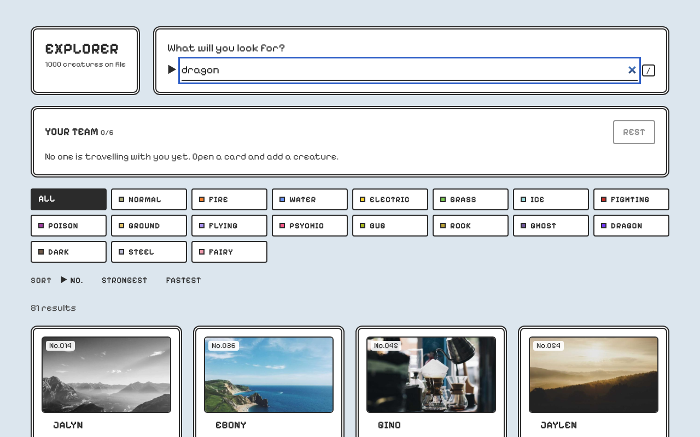 | 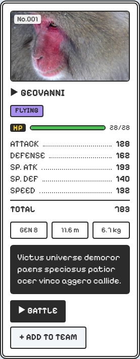 | 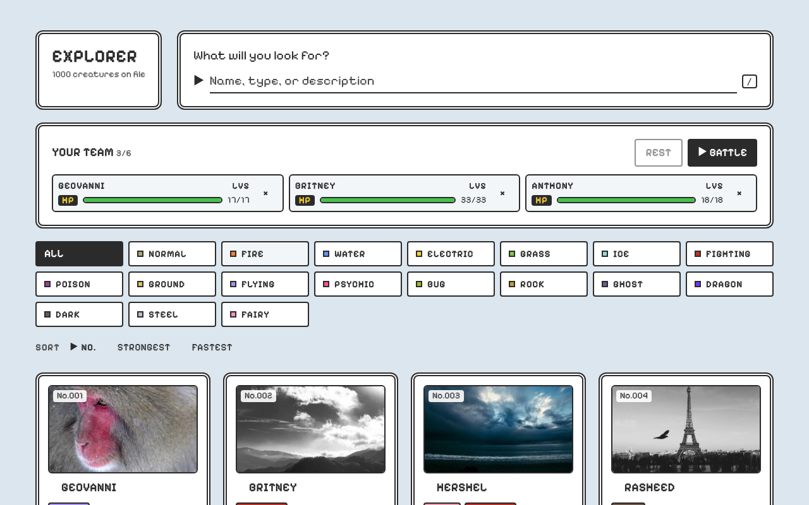 |

## Battle

Your team fights wild creatures on a "Pocket Explorer" handheld. Pick FIGHT, choose a move, and stop the timing bar
in the middle for extra damage; win to gain XP and levels, or try to catch the wild creature. The **Classic** toggle
switches between the four-green screen and full color.

<p align="center"></p>

| Classic screen | Timing bar | Color | Victory |
| --- | --- | --- | --- |
| 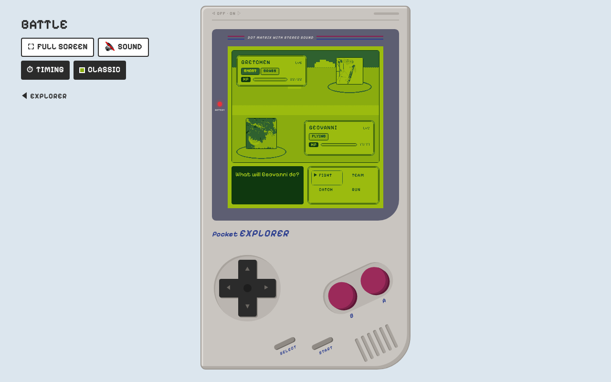 | 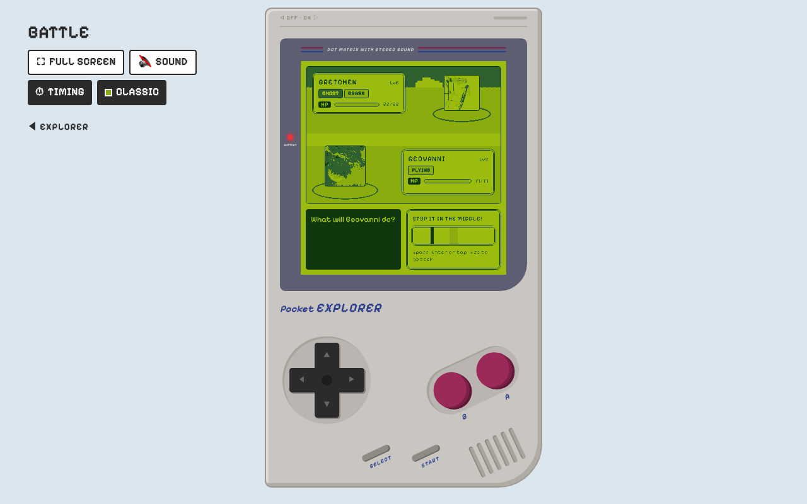 | 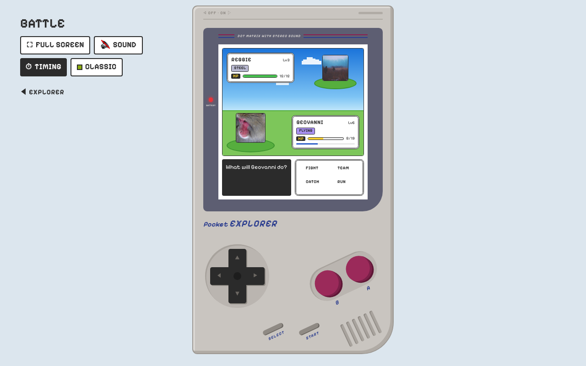 | 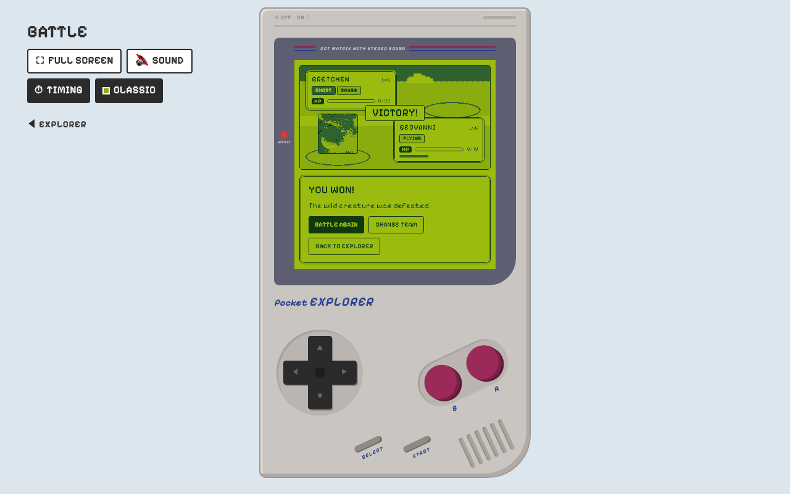 |

## Creature Lab

Name a creature, pick up to two types, describe it, and the lab draws its card. Image generation runs on Vertex AI,
so it needs the deployed app or local Google Cloud credentials.

<p align="center">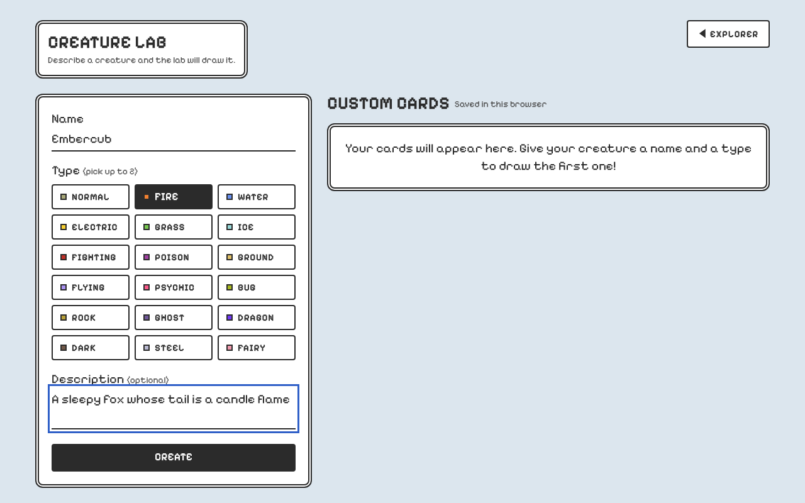</p>

## On a phone

Everything works at phone width; the battle drops the console shell and fills the screen.

<p align="center">
  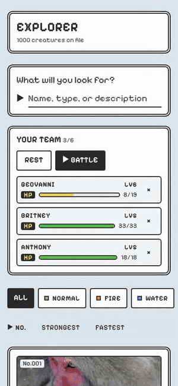
  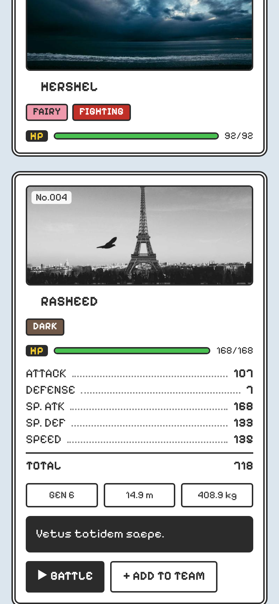
  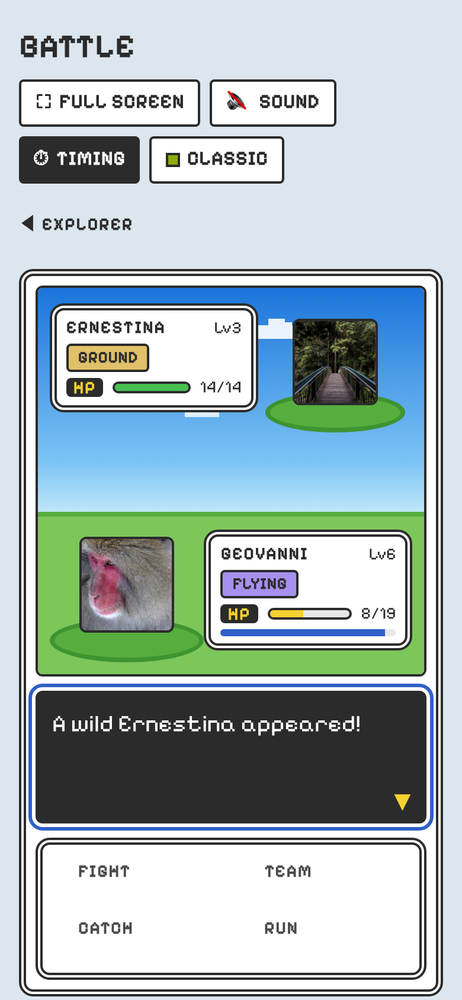
</p>

## Architecture

One container on Cloud Run serves the React app and the Express API. The 1,000 creatures are a JSON file bundled
with the server, so search, filter, sort and paging run in `server/query.ts` with no database. Your team and custom
cards stay in your browser. Only the Creature Lab calls out, to Gemini on Vertex AI, behind rate limits.

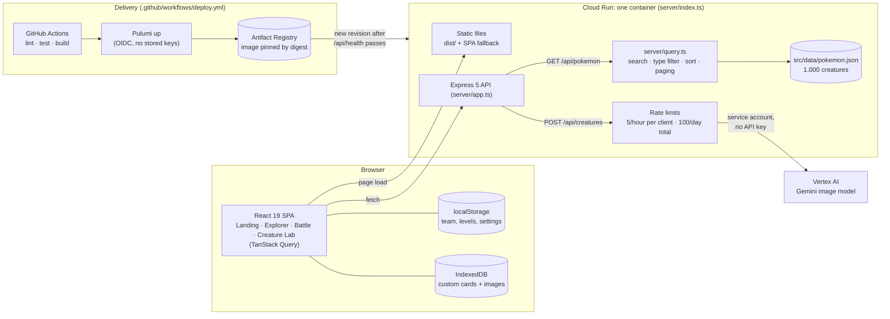

In dev, `pnpm dev` mounts the same `server/app.ts` as Vite middleware, so the API and the app share
`localhost:5173`. Infra details: [`docs/deployment.md`](docs/deployment.md).

## Run it

```bash
pnpm install
pnpm dev        # http://localhost:5173 (API served by the same Vite dev server)
pnpm test       # Vitest + Testing Library
pnpm lint && pnpm build && pnpm start   # production build on http://localhost:3000
```

## Repo map

| Path | What |
| --- | --- |
| [`src/`](src/), [`server/`](server/) | React + Vite app and Express API, at the repo root ([assignment brief](docs/brief.md)) |
| [`infra/`](infra/) | Pulumi (TypeScript) deploying to Google Cloud Run ([how it deploys](docs/deployment.md)) |
| [`.github/workflows/`](.github/workflows/) | Lint, test, build, deploy, per-PR preview environments and AI review |
| [`docs/decisions.md`](docs/decisions.md) | Decision log |
| [`docs/media/`](docs/media/) | The screenshots, GIFs and walkthrough video above |
