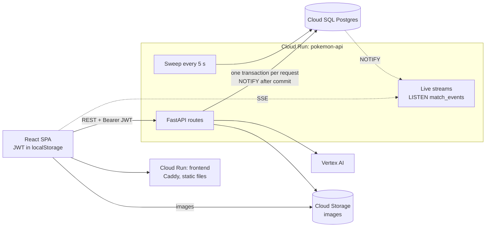
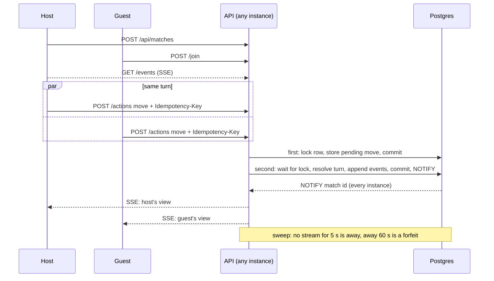

# Pokemon Explorer: the backend

A Full FastAPI service on Postgres behind a Pokémon-style game: accounts, a 1,000-creature catalog, teams, wild battles,
friend battles between two players, and AI-drawn creatures. It replaces the mocked Express API of FINNY's frontend
take-home. The app itself: [`docs/frontend.md`](docs/frontend.md).

- **Live app:** https://pokemon-explorer-605570978921.us-central1.run.app
- **API docs (Swagger):** https://pokemon-api-ogxllptvoa-uc.a.run.app/api/docs

## The question

> What does the Pokémon system look like in a multi-tenant system where tenants can choose Pokémon to battle each
> other? Pokémon battles are long-lived processes.

- **Tenants:** here a tenant is a player account. Everything a player owns is keyed by their user id, and every query
  filters by it. The catalog is the one shared resource.
- **Long-lived battles:** a battle isn't a running process. It's a state machine in a Postgres row, and each move is
  one short transaction. Live updates go out over server-sent events, fanned out across instances with Postgres
  `LISTEN/NOTIFY`, and a background sweep handles timeouts.

So a battle can last minutes or days, survives deploys, and any instance can serve either player.

## Architecture



API instances are stateless: every fact lives in Postgres. Plain SQL with psycopg 3 and numbered migrations, no ORM.
Deploys go through GitHub Actions and Pulumi ([`docs/deployment.md`](docs/deployment.md)).

## Tables

| Table | Holds | Owner |
| --- | --- | --- |
| `users` | username, argon2id hash | the tenant |
| `pokemon` | the catalog (`owner_id IS NULL`) and custom creatures (`owner_id` set) | shared + per user |
| `team_members` | up to 6 per user: creature, slot, level, XP, HP | user |
| `wild_battles` | one wild battle per user: `state jsonb`, `turn` | user |
| `matches` | a friend battle: both seats, locked-in teams, pending moves, `state`, `events`, presence, outcome | two users |
| `match_actions` | idempotency keys per user per match | user |
| `lab_requests` | one row per creature drawing (rate limits) | user |

**Keeping tenants apart:**

- The user id comes from a verified JWT, never from the request body, and every query filters by it.
- Someone else's creature is a 404, not a 403.
- In a match each player gets their own view: the opponent's move shows only as "acted" until the turn resolves.
- A locked-in creature is read `FOR SHARE`, so its owner can't delete it mid-match.

## A friend battle



- **Exactly once:** both players' moves take `SELECT … FOR UPDATE` on the match row. The second sees both moves and
  resolves the turn; a test fires both at once to prove it.
- **Safe retries:** every action carries an `Idempotency-Key`, so a retried request is answered, not replayed.
- **Across instances:** `NOTIFY` is only a hint. Each instance re-reads the row before sending a view, so a missed
  notification costs nothing a reconnect doesn't fix.
- **Limits:** 20 matches per host per hour, 500 open; the AI lab allows 5 drawings per user per hour and 100 a day.

## Trade-offs

| Choice | Instead of | Cost |
| --- | --- | --- |
| A battle is a row and a state machine | a process or actor per battle | a database round trip and row lock per move |
| Row lock per match | optimistic versions, a queue per match | a connection held while a turn resolves (ms) |
| Postgres `LISTEN/NOTIFY` | RabbitMQ, Redis pub/sub | not durable, one listening connection per instance |
| Server-sent events | WebSockets | the token goes in `?token=` (EventSource can't send headers) |
| A sweep in every instance | Cloud Tasks, Temporal | timeouts are only accurate to ~5 s |
| In-house auth: argon2id + one 1-hour JWT | Auth0, refresh tokens | no revocation; sign in again hourly |
| Plain SQL | an ORM | more boilerplate per query |

## Next steps

- **Organizations as tenants:** a `tenant_id` on every table, enforced with Postgres row-level security, plus quotas
  per tenant. Teams would be snapshotted at lock-in for battles between tenants.
- **Durable events:** an outbox table published through Pub/Sub, so clients can resume with `Last-Event-ID`.
- **Timers in a scheduler** (Cloud Tasks or Temporal) instead of scanning matches every 5 s.
- **Auth:** refresh tokens with revocation, httpOnly cookies, and rate limits on signup and login.
- **Matchmaking** with a `SKIP LOCKED` queue, and replays from the event log plus a per-match seed.

## Run it

```bash
pnpm install
docker compose up -d --wait db   # Postgres 17 on :54329
pnpm dev:api                     # FastAPI on :8000 (runs migrations; Swagger at /api/docs)
pnpm dev                         # the app on :5173, proxies /api to FastAPI
cd api && uv run pytest          # API tests against real Postgres
```
