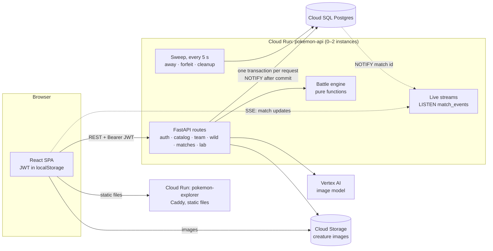
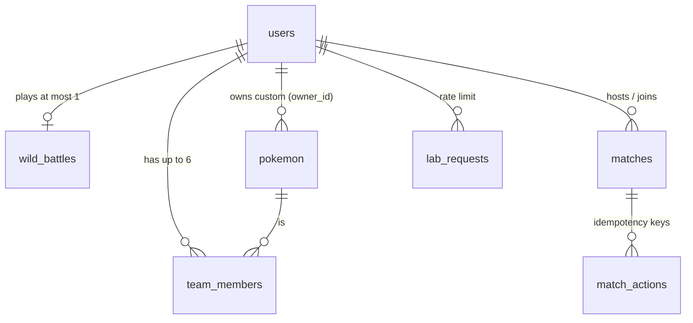

# Pokemon Explorer: the backend

A FastAPI service on Postgres behind a Pokémon-style game: accounts, a 1,000-creature catalog, teams, wild battles,
friend battles between two players, and AI-drawn custom creatures. It started as FINNY's frontend take-home (React on
a mocked Express API); this repo replaces the mock with a real backend. What the app looks like:
[`docs/frontend.md`](docs/frontend.md).

- **Live app:** https://pokemon-explorer-605570978921.us-central1.run.app
- **API docs (Swagger):** https://pokemon-api-ogxllptvoa-uc.a.run.app/api/docs

<p align="center"></p>

## The question

FINNY's backend prompts:

> What does the Pokémon system look like in a multi-tenant system where tenants can choose Pokémon to battle each
> other? Pokémon battles are long-lived processes.

**Short answer.** In this build a tenant is a player account.

- **Data:** everything a player owns is a row keyed by their user id: their team, their creatures, their seat in a
  match. Every query filters by the caller's id. The catalog is the one shared resource.
- **Battles:** a battle is not a running process. It is a state machine stored in a Postgres row.
  - Each move is one short transaction: lock the row, apply the move, save, commit.
  - Live updates go out over server-sent events, with Postgres `LISTEN/NOTIFY` fanning them out across instances.
  - A background sweep handles time: who's away, who forfeits, what to clean up.

So a battle can last minutes or days. It survives deploys, restarts and instance changes, and any instance can serve
either player. The sections below show how, and what changes when a tenant means a whole organization.

## Architecture



- **Stateless API instances.** Every fact lives in Postgres. An instance only holds open SSE connections, and they
  re-read from the database.
- **Plain SQL** with psycopg 3 and numbered `.sql` migrations that run at startup under an advisory lock. No ORM.
- **Deploys** go through GitHub Actions and Pulumi. Each image is pinned by digest, and Cloud Run only switches traffic
  once `/api/health` (which checks the database) passes. Details: [`docs/deployment.md`](docs/deployment.md).

## Tenancy: who owns what



| Table | What it holds | Tenancy |
| --- | --- | --- |
| `users` | username (unique, case-insensitive), argon2id hash | the tenant |
| `pokemon` | the catalog (ids 1–1000, `owner_id IS NULL`) and custom creatures (ids from 1001, `owner_id` set) | shared catalog + per-user rows in one table |
| `team_members` | up to 6 per user: creature, slot, level, XP, HP | `user_id` in the primary key |
| `wild_battles` | one in-progress wild battle per user: `state jsonb`, `turn` | `user_id` is the primary key |
| `matches` | a friend battle: both seats, locked-in teams, pending moves, `state jsonb`, `events jsonb`, presence per seat, outcome | two users per row (`host_id`, `guest_id`) |
| `match_actions` | idempotency keys: `(match_id, user_id, key)` → request hash and status | per user per match |
| `lab_requests` | one row per creature-drawing request | per user, plus a global daily count |

**How tenants stay apart:**

- **The token decides the user.** The user id comes from a verified JWT (`current_user`), never from the request
  body.
- **Every query is scoped by that id.** Ownership is enforced in SQL: `WHERE user_id = %s`, or
  `owner_id IS NULL OR owner_id = %s` for creatures. Someone else's creature is a 404, not a 403, so ids don't
  confirm what exists. Tests cover cross-user access for creatures, teams, match lock-ins, match actions and live
  streams.
- **Cross-tenant battles see only what's theirs.** Each player gets their own view of the match: the opponent's
  move shows only as "acted", never what it was. A player can lock in only catalog creatures and their own. Once
  locked in, a creature is read `FOR SHARE`, so its owner can't delete it mid-match (409).
- **Foreign keys cascade from `users`.** Removing a user removes their team, battles, matches, creatures and limit
  rows in one statement.

## Battles as long-lived processes

A friend battle can sit for minutes between moves, both players can move at the same instant, phones drop their
connection, and the server redeploys mid-match. Here is how a match is run:

```mermaid
sequenceDiagram
  participant H as Host browser
  participant G as Guest browser
  participant A as API (any instance)
  participant P as Postgres

  H->>A: POST /api/matches
  A->>P: INSERT matches (8-char id)
  H-->>A: GET /events?token= (SSE)
  G->>A: POST /join
  H->>A: POST /actions {team} + Idempotency-Key
  G->>A: POST /actions {team} + Idempotency-Key
  A->>P: BEGIN · SELECT … FOR UPDATE · both teams in → start battle · COMMIT · NOTIFY
  P-->>A: NOTIFY match id (every instance)
  A-->>H: SSE: host's view
  A-->>G: SSE: guest's view
  par same turn
    H->>A: POST /actions {move}
  and
    G->>A: POST /actions {move}
  end
  A->>P: first: lock, store pending move, commit
  A->>P: second: waits for lock, sees both moves → resolve turn → append events → commit · NOTIFY
  Note over A,P: sweep every 5 s: no stream for 5 s → "away"; away 60 s → forfeit
```

**The design, piece by piece:**

- **State is data, not a process.** `matches.state` is the whole battle (fighters, HP, whose turn), and
  `matches.events` is the append-only log the browser replays. The engine is pure functions:
  `(state, moves, rng) → (state, events)`. Nothing lives in memory between requests, so a deploy loses nothing.
- **Concurrency.** Every action takes `SELECT … FOR UPDATE` on the match row, so both players' requests run one at a
  time. When both move at once, the first stores its move as pending, and the second sees both and resolves the
  turn. It resolves exactly once; a test fires both moves together to prove it.
- **Retries are safe.** Each move carries an `Idempotency-Key`. A retry returns the stored status. Reusing a key with
  a different move is a 409.
- **Live updates across instances.** After a commit the route sends `NOTIFY match_events, '<id>'`. Every instance
  listens, and any instance holding a stream for that match re-reads the row and sends each player their own view.
  The notification is only a hint: a missed one costs nothing that reconnecting doesn't fix, because the data always
  comes from the row.
- **Presence and timeouts.** Each seat records its current stream id and a heartbeat. Opening a newer stream (a
  second tab) takes over the seat. The sweep runs every 5 s on each instance and also at the start of match routes,
  so it still runs when Cloud Run has scaled to zero:
  - no live stream for 5 s marks the seat "away"
  - away for 60 s in a battle is a forfeit
  - unstarted matches expire after 30 min, and finished ones are removed after 10 min

  Concurrent sweeps are safe: each `UPDATE` re-checks its `WHERE` after waiting for the row lock.
- **Wild battles** use the same pattern with one row per user (`wild_battles`), and each turn also writes HP, XP and
  catches back to the team in the same transaction.
- **Abuse limits.** A host can create at most 20 matches per hour, and at most 500 can be open at once. Lab
  drawings: 5 per user per hour and 100 a day overall. Each limit is counted in Postgres under locks, so it holds
  across instances and deploys.

## Design decisions and trade-offs

Each choice below has a full entry (what, why, what was rejected, the cost) in
[`docs/backend/decisions.md`](docs/backend/decisions.md).

| Choice | Instead of | Why | Cost |
| --- | --- | --- | --- |
| A battle is a row and a state machine | a process or actor per battle | survives deploys; any instance serves any player; one source of truth | each move is a database round trip with a row lock |
| `SELECT … FOR UPDATE` per match | optimistic versioning, a queue per match | two players, low contention: the simplest thing that resolves a turn exactly once | holds a connection while the turn resolves (milliseconds) |
| Postgres `LISTEN/NOTIFY` | RabbitMQ / Redis pub/sub | no new infrastructure; the database already orders the writes | not durable, ~8 KB payload limit, one listening connection per instance |
| Server-sent events | WebSockets | one-way push is all a battle needs; moves stay plain REST with idempotency | the token goes in `?token=` (EventSource can't send headers) |
| A sweep in every instance | a scheduler or workflow engine (Cloud Tasks, Temporal) | timers are just timestamps on the row; any instance can run them | timing is only to within ~5 s |
| Auth built in-house: argon2id + one 1-hour JWT | Auth0, Supabase Auth, refresh tokens | small, and every line is explainable | no revocation; you sign in again every hour; token in `localStorage` (XSS risk) |
| One `pokemon` table, `owner_id` for custom creatures | a separate `creatures` table | teams and battles look up one table | every catalog query must keep `owner_id IS NULL` (tested) |
| Plain SQL and numbered migrations | an ORM (SQLAlchemy) | queries read as written; easy to review and to tune | more boilerplate per query |
| Lab limits in Postgres, counted before the drawing | in-memory counters | shared across instances, survive deploys | a failed drawing still uses a slot |

## Where I'd take it next

**Tenants as organizations.** If a tenant is a company with its own players:

- Add `tenant_id` to every table, and make it the first column of every key and index.
- Enforce it with Postgres row-level security as well as the application's `WHERE`, so a forgotten filter fails closed.
- Put the tenant in the JWT, and set `app.tenant_id` on each connection.
- Battles between tenants become an explicit contract. The match row records both tenants. Teams are snapshotted at
  lock-in, so a tenant editing its catalog can't change a battle in progress (today the battle state is already a
  copy; the lock-in uses `FOR SHARE`).
- Give each tenant its own quotas and rate limits. The biggest tenants could later move to their own database (a
  shard per tenant), since nothing joins across tenants except a match.

**Battles at scale:**

- **Durable events.** `NOTIFY` is fire-and-forget. With many instances I'd append events to an outbox table and
  publish them through Pub/Sub or Redis Streams. Clients would resume with `Last-Event-ID` instead of re-reading the
  whole view.
- **Timers in a scheduler.** At high match counts, Cloud Tasks or Temporal would replace the every-instance sweep:
  one timer per match, without scanning the table.
- **Matchmaking and ranking.** A queue table with `SKIP LOCKED` to pair players, and Elo per tenant.
- **A replayable history.** Store an rng seed per match; with the event log, any battle could be replayed exactly,
  for disputes or anti-cheat.

**The rest:**

- Refresh tokens with rotation and revocation, and httpOnly cookies instead of `localStorage`.
- Rate limits on signup and login (today only the Lab is limited, per account).
- A job queue for image generation, so the request doesn't wait for the model.
- Read replicas for the catalog.
- Tracing and metrics per route and per match.
- Catalog images moved into the bucket (slice 7; today they're slow placeholder URLs).

## Run it

```bash
pnpm install
docker compose up -d --wait db   # Postgres 17 on :54329
pnpm dev:api                     # FastAPI on http://localhost:8000 (runs migrations; Swagger at /api/docs)
pnpm dev                         # the app on http://localhost:5173; proxies /api to FastAPI
```

Tests:

```bash
cd api && uv run pytest          # API: 434 tests against real Postgres (wiped per test)
pnpm test                        # frontend
```

The Creature Lab needs Google Cloud credentials (`gcloud auth application-default login`) plus `GOOGLE_CLOUD_PROJECT`
and `CREATURE_BUCKET`; without them it answers 503.

## Layout

| Path | What |
| --- | --- |
| `api/app/` | FastAPI: `routes/`, `auth/`, `engine/` (battle rules), `battles/`, `matches/` (actions, live streams, sweep), `lab/`, `db/migrations/` |
| `api/tests/` | pytest against real Postgres, including concurrency and cross-user tests |
| `src/` | the React app |
| `infra/` | Pulumi: the app stack (CI) and `bootstrap/` (owner-run: Cloud SQL, secrets, IAM, bucket) |
| `docs/backend/decisions.md` | every backend decision and its trade-off |
